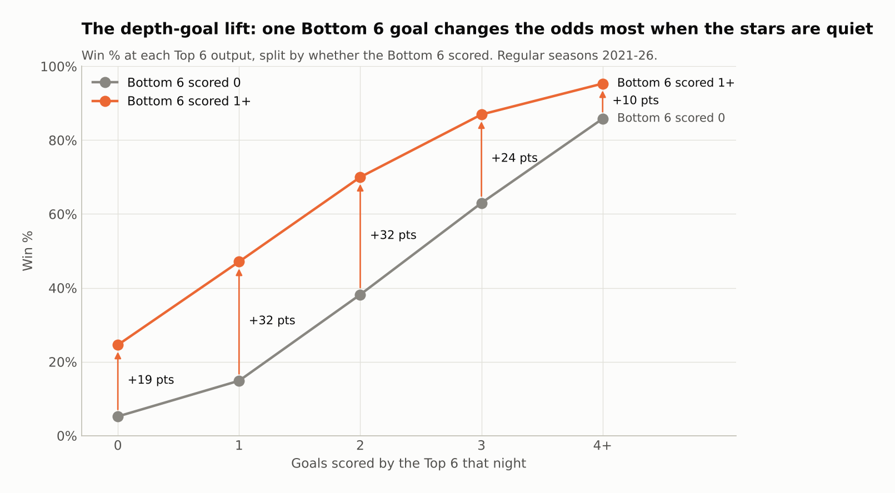

# NHL: Top 6 vs Bottom 6 forwards

How much do a team's Top 6 forwards contribute to winning compared with its Bottom 6? And two theory questions:
* What would the Top 6 have to do if there were **no Bottom 6**?
* What kind of Bottom 6 helps **any** team win?

**Web page: [luca-pfi.github.io/NHL](https://luca-pfi.github.io/NHL/)** (the report as a page, light and dark mode)

**Full write-up: [REPORT.md](REPORT.md)** (14 charts, every number sourced from [`results/summary.json`](results/summary.json)).



## Headline findings (2021-22 to 2025-26, 6,993 games)

* **Scoring:** the Top 6 score 60% of team goals and the Bottom 6 25%. At 5-on-5 the gap shrinks: the Bottom 6 score 36% of forward 5v5 goals on 42% of the even-strength ice time.
* **A goal is a goal:** each goal multiplies the odds of winning by about 3.3 whoever scores it, and Bottom 6 goals are just as often go-ahead or tying goals.
* **Depth goals swing games:** when the Top 6 score only once, a Bottom 6 goal lifts win % from 15% to 47%.
* **No Bottom 6:** erasing every Bottom 6 goal costs an average team about 18 standings points. To cover that, the Top 6 would need 2.62 goals a game, a level only 1 of 160 team-seasons reached. A two-line team breaks even only if 30-minute nights cost the stars less than about 3.5%. Back-to-backs alone cost them 5%.
* **Bottom 6 recipe:** don't lose your minutes (goals-against suppression is the biggest lever), chip in goals, finish chances, and win the penalty battle. Hits, blocked shots and faceoffs don't predict winning.
* **Playoffs:** all five Cup champions had a Bottom 6 with positive even-strength goal differential. The other playoff teams' Bottom 6 groups averaged negative.

## Repository layout

```
REPORT.md                 full analysis write-up
index.html                the report as a web page (served by GitHub Pages)
figures/                  all charts (PNG); figures/dark/ holds the dark-mode versions
results/                  the table behind every chart + summary.json + model_info.json
src/fetch_games.py        download boxscore + play-by-play for every game (api-web.nhle.com)
src/build_dataset.py      raw JSON -> player-game, shot, goal and manpower tables
src/models.py             expected-goals model and in-game win-probability model
src/features.py           Top 6 / Bottom 6 roles, even-strength on-ice estimates, team-game and team-season tables
src/analysis.py           every analysis, chart and number in the report
src/render_dark_figures.py  redraw every chart with the dark palette (figures/dark/)
src/style.py              chart palette and styling
data/processed/           analysis-ready tables (see below)
run_all.sh                runs the whole pipeline
```

### Data files (`data/processed/`)
| File | Grain | What's in it |
|---|---|---|
| `games.csv` | game | teams, score (excluding shootout), OT/SO, ES/PP/PK seconds |
| `player_games_enriched.csv.gz` | skater x game | boxscore and play-by-play stats, xG, WPA, Top 6 / Bottom 6 role |
| `goals_enriched.csv.gz` | goal | manpower, score state, WPA, game-winner flag, line-group attribution |
| `team_games.csv.gz` | team x game | result, plus every stat summed by Top 6 / Bottom 6 / D |
| `team_seasons.csv` | team x season | points %, playoffs, per-60 and even-strength on-ice rates by group |

The big intermediate files (`shots.csv.gz`, `wp_states.csv.gz`) and the raw JSON cache are git-ignored. `./run_all.sh` regenerates them.

## Reproduce

```bash
pip install -r requirements.txt
```

```bash
./run_all.sh
```

The first run downloads about 7,000 games (~8 minutes at 8 parallel requests, cached in `data/raw/`). Later runs take about 2 minutes.
