# Top 6 vs Bottom 6 forwards: who actually wins NHL games?

**Data:** every regular-season and playoff game from 2021-22 to 2025-26. That is 6,560 regular-season games, 433 playoff games, 160 team-seasons, 251,689 skater-games, 824,318 shot attempts and 43,110 goals, all from the public NHL web API (`api-web.nhle.com`).
**Every number below** comes from [`results/summary.json`](results/summary.json). The table behind each chart is in [`results/`](results/).

---

## TL;DR

| Question | Answer |
|---|---|
| How much of the scoring comes from each group? | The Top 6 score **60%** of all team goals, the Bottom 6 **25%** and defensemen **15%**. Among forwards only, the Bottom 6 play **41%** of the minutes and score **30%** of the goals. |
| Is a Bottom 6 goal worth less? | **No.** A goal raises the odds of winning by the same amount (x3.3) whoever scores it. Bottom 6 goals are almost as high-leverage: they tie or take the lead **49.5%** of the time, against 49.8% for the Top 6. |
| How much does depth scoring matter? | Teams win **62%** of games in which the Bottom 6 score and **36%** of games in which they don't. When the Top 6 score only once, one Bottom 6 goal lifts win % from **15% to 47%**. |
| How much of the gap between teams does each group explain? | Top 6 even-strength goal differential explains **35%** of the explained differences in standings, the Bottom 6 **25%**, special teams **23%**, and empty-net / extra-attacker goals 17%. |
| **Theory A:** what would the Top 6 need with no Bottom 6? | Erase every Bottom 6 goal and an average team drops from **91 to ~73 points**: 17.8 standings points and 8.5 wins per 82 games. To cover that, the Top 6 would need **2.62 goals a game (+41%)**. Only **1 of 160** team-seasons managed it. A "two-line team" breaks even only if the stars lose less than **~3.5%** of their effectiveness from playing ~30 minutes a night. Playing the second game of a back-to-back already costs them **5%**. |
| **Theory B:** what kind of Bottom 6 helps any team win? | One that **doesn't lose its minutes**. Bottom 6 goals against per 60 is the strongest single bottom-6 trait (partial r = -0.46), followed by scoring and drawing more penalties than they take. **Hits, blocked shots and faceoffs do not predict winning.** Only **34%** of real Bottom 6 groups break even at even strength. **All 5 Stanley Cup champions** in the sample had a Bottom 6 that won its minutes in the playoffs, while the other playoff teams' Bottom 6 groups averaged a negative goal differential. |

**Bottom line:** the Top 6 decide how high a team's ceiling is, and the Bottom 6 decide whether the team stays above water when the stars sit. Strong-Top-6 teams with a weak Bottom 6 averaged **96 points** and made the playoffs **61%** of the time. Strong-Top-6 teams with a strong Bottom 6 averaged **106 points** and made the playoffs **91%** of the time.

---

## 1. Definitions and method

**Top 6 / Bottom 6.** Each forward's role is his **average time on ice (TOI) for that team that season**, computed separately for the regular season and the playoffs. In every game the dressed forwards are ranked by that role TOI: ranks 1-6 are the Top 6 and ranks 7+ are the Bottom 6 (usually six players, five when a team dresses 11 F / 7 D). Using the season role instead of that night's TOI avoids game-script bias, for example a 4th liner who plays more because the team killed six penalties. Section 7 shows the results hold with the in-game definition too.

**Stats used.** From the boxscore: TOI, shifts, +/-, hits, blocks, takeaways, giveaways and PIM. From the play-by-play, rebuilt for every player: goals and assists by manpower (5v5, ES, PP, SH, empty net), shot attempts, shots on goal, penalties taken and drawn, faceoffs by zone, game-winning, go-ahead and tying goals.

**Two models built from the play-by-play.**
* **Expected goals (xG):** a gradient-boosted model on shot distance, angle, type, rebound, rush, manpower and empty net. It was trained leave-one-season-out so no shot is scored by a model that saw it. AUC = 0.77, and predicted goals match real goals within about 6% each season.
* **Win probability:** P(win | clock, score, playoffs), AUC = 0.81. Every goal gets a **Win Probability Added (WPA)** = win probability after the goal minus before it.

**Even-strength on-ice goals by line group (estimated).** The public API has no shift charts or on-ice player lists. The NHL's shift endpoints were also blocked from the environment this was built in. So each group's on-ice goals for and against are rebuilt from three things:
1. The team's even-strength, power-play and penalty-kill seconds, measured from the play-by-play manpower timeline.
2. Each group's TOI and summed +/-.
3. Who scored or assisted every goal.

A regression of group TOI on team ES/PP/PK seconds gives deployment: the Top 6 take **58%** of even-strength forward time, **70%** of power-play time and **62%** of penalty-kill time. +/- credits for shorthanded, empty-net and extra-attacker goals are removed, which leaves clean even-strength goal differential. Two checks support the reconstruction: the groups' estimated even-strength goals against add up to the real total (2.142 vs 2.146 per game), and Top 6 + Bottom 6 even-strength goal differential correlates **0.998** with each team's actual even-strength goal differential.

---

## 2. What each group contributes

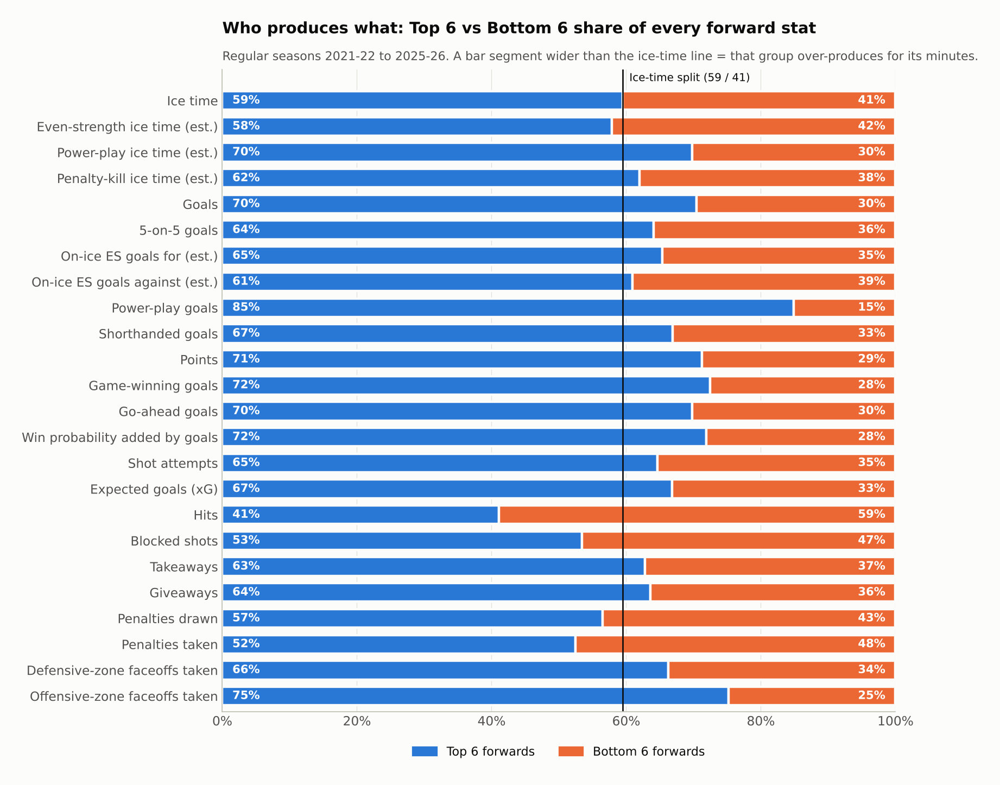

* **Scoring is top-heavy.** The Top 6 play 59% of forward minutes but score 70% of forward goals, 85% of power-play goals and 72% of game-winners.
* **The gap is much smaller at 5-on-5.** The Bottom 6 score **36%** of forward 5-on-5 goals on 42% of the even-strength time. Most of the Top 6's scoring edge comes from the power play.
* **The physical work belongs to the Bottom 6.** They deliver 59% of forward hits and 47% of forward blocked shots. They also take 48% of the penalties.
* **Deployment is defensive.** Only 42% of Bottom 6 offensive/defensive-zone faceoffs are in the offensive zone, against 53% for the Top 6.

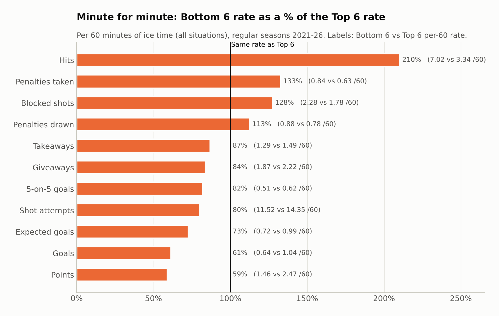

Minute for minute, a Bottom 6 forward produces **61%** of a Top 6 forward's goals, **73%** of the expected goals and **82%** of the 5-on-5 goals. He also hits **2.1x** as often and takes **33% more** penalties. Bottom 6 forwards shoot **10.2%** against 13.3% for the Top 6, and they score 0.08 goals/60 *below* their expected goals. They get decent chances and finish them worse.

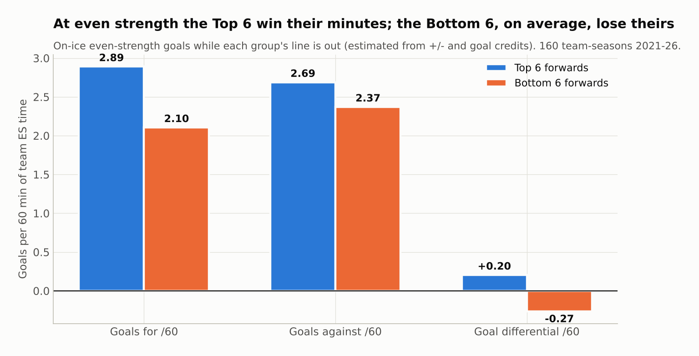

At even strength, the Top 6 outscore opponents **2.89-2.69 per 60** (51.8% of goals), while the Bottom 6 are outscored **2.10-2.37** (47.0%). The Bottom 6 actually allow *fewer* goals per 60. Their problem is offense. Only **34%** of Bottom 6 groups in the sample had a positive even-strength goal differential, against 64% of Top 6 groups.

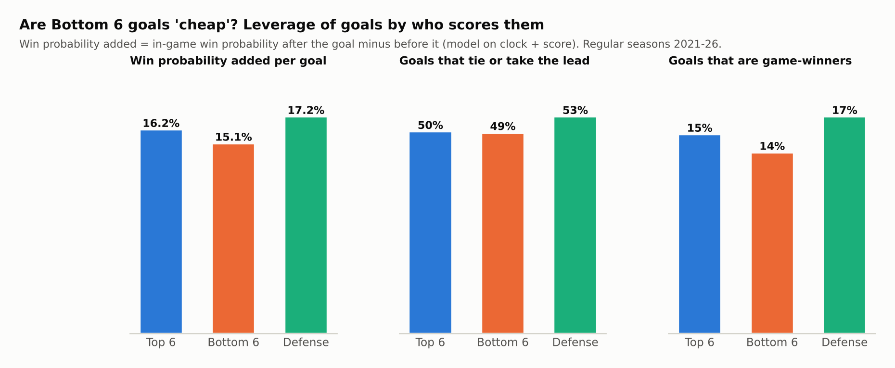

Bottom 6 goals are **not cheap**. Each one adds **15.1%** win probability on average, against 16.2% for a Top 6 goal. Half of them tie the game or take the lead, the same rate as Top 6 goals. A logistic model confirms that one more goal multiplies the odds of winning by **3.29** from the Bottom 6 and **3.35** from the Top 6, which is statistically identical.

---

## 3. How it turns into wins

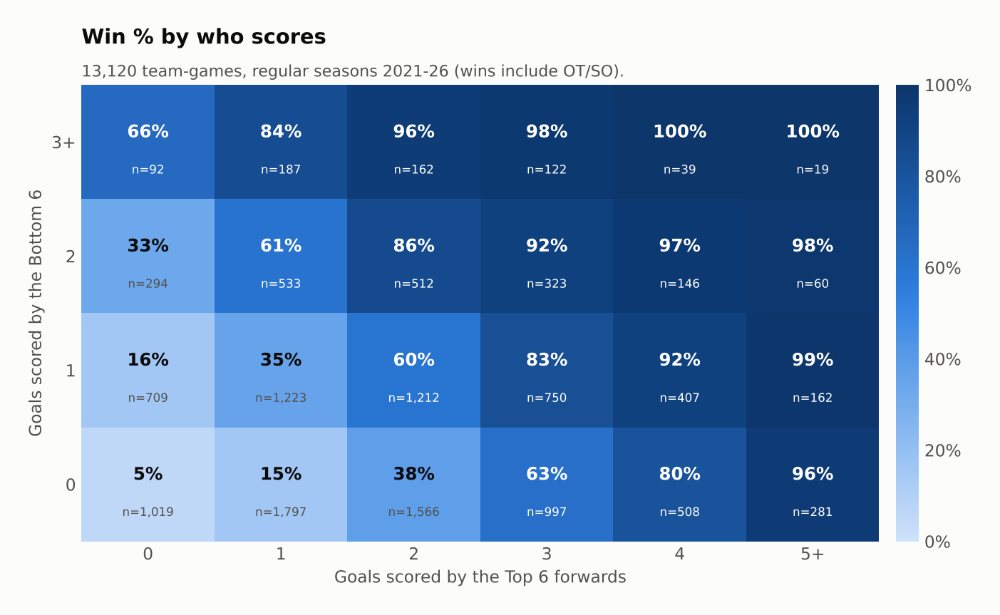

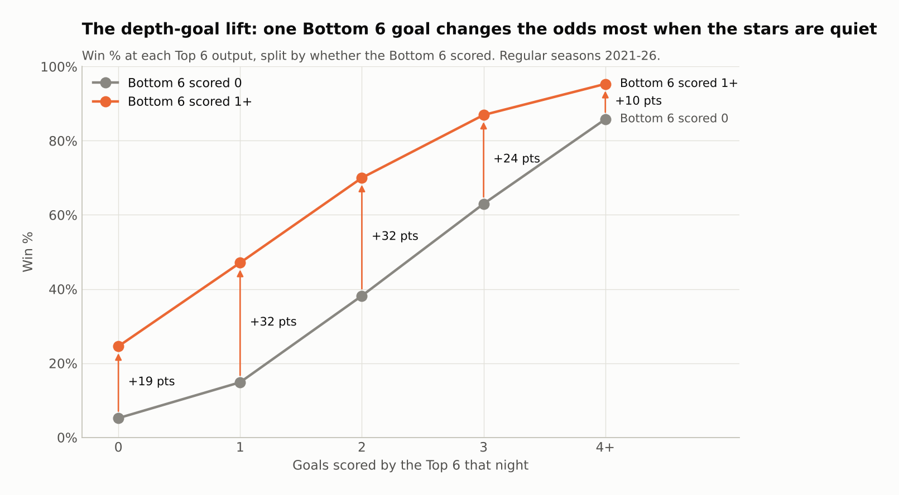

A depth goal matters most when the stars are quiet. The Top 6 score one goal or fewer in **45%** of games. In those games:

| Top 6 goals | Win % if Bottom 6 score 0 | Win % if Bottom 6 score 1+ | Lift |
|---|---|---|---|
| 0 | 5% | 25% | +19 pts |
| 1 | 15% | 47% | **+32 pts** |
| 2 | 38% | 70% | **+32 pts** |
| 3 | 63% | 87% | +24 pts |
| 4+ | 86% | 95% | +10 pts |

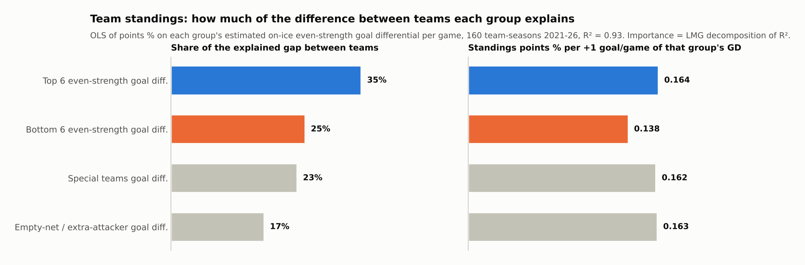

**Team-season model (160 team-seasons, R² = 0.93).** Points % was regressed on four parts of goal differential per game: Top 6 even-strength, Bottom 6 even-strength, special teams, and empty-net / extra-attacker goals. A goal of differential is worth about the same whichever group produces it (0.16 vs 0.14 points % per goal per game). The groups differ in **how much teams vary** on each part.
* The Top 6 explain **35%** of the explained gap between teams and the Bottom 6 **25%**, more than special teams (23%).
* Counting forwards only, that is a 59 / 41 split, almost exactly their 58 / 42 split of even-strength ice time.

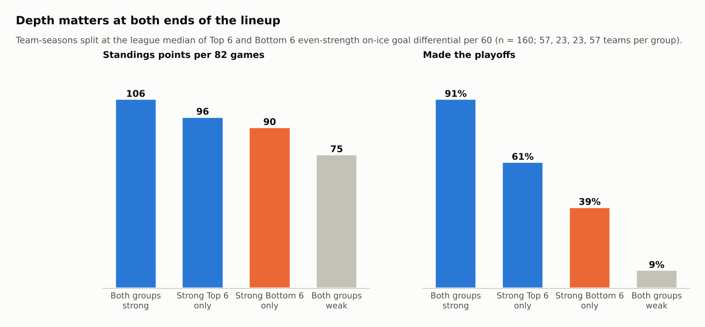

| Team type (split at league median) | Teams | Points / 82 | Made playoffs |
|---|---|---|---|
| Strong Top 6 + strong Bottom 6 | 57 | **106** | **91%** |
| Strong Top 6 only (top-heavy) | 23 | 96 | 61% |
| Strong Bottom 6 only (deep) | 23 | 90 | 39% |
| Both weak | 57 | 75 | 9% |

With a strong Top 6, adding a strong Bottom 6 is worth about **+10 points and +30 percentage points of playoff probability**.

---

## 4. Theory A: what would the Top 6 need if there were no Bottom 6?

Three ways to look at it, from most to least literal.

### Lens 1: erase depth scoring
Erase every Bottom 6 goal from every game and re-score the games, holding everything else fixed:

* Win % falls from 50.0% to **39.6%** and points % from .556 to **.447**. That costs **8.5 wins and 17.8 standings points per 82 games**, enough to turn a 91-point bubble team into a 73-point lottery team.
* **30%** of all wins needed at least one Bottom 6 goal.
* To make up the difference, the Top 6 would have to score **2.62 goals a game**, up from 1.86, a **41%** increase. Only **1 of 160** team-seasons (0.6%) had a Top 6 that productive, and the best ever was 2.74.

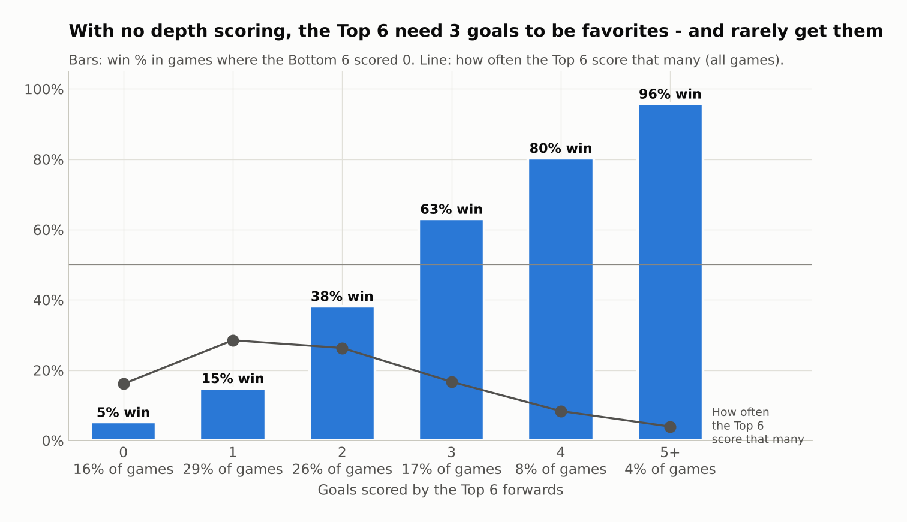

On a single night with no depth scoring, the Top 6 need **three goals** just to be favorites (63% win). They score 3+ in only **29%** of games.

### Lens 2: a replacement-level Bottom 6
Instead of zero goals, suppose the Bottom 6 is as bad as the worst real units. How good must the Top 6 be to still make the playoffs (points % ≈ .564)?

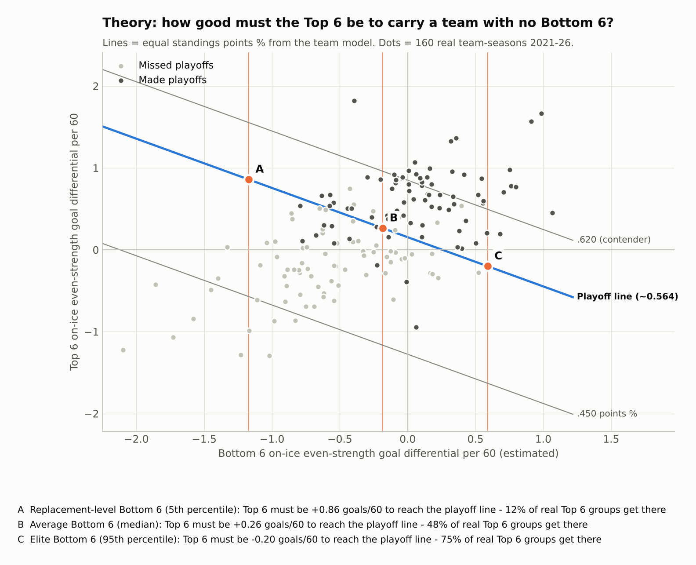

| Bottom 6 quality (even-strength GD/60) | Top 6 needed for **playoff line** | Real Top 6 groups that good | Top 6 needed for **.620 contender** | Real Top 6 groups that good |
|---|---|---|---|---|
| Replacement (5th pct, -1.17) | +0.86 /60 | 12.5% | +1.55 /60 | **1.9%** |
| Weak (25th pct, -0.63) | +0.53 | 31% | +1.23 | 3.1% |
| Average (median, -0.18) | +0.26 | 48% | +0.96 | 5.6% |
| Strong (75th pct, +0.13) | +0.08 | 60% | +0.77 | 16.9% |
| Elite (95th pct, +0.59) | **-0.20** | **75%** | +0.50 | 34% |

With a replacement-level Bottom 6, only about 1 Top 6 in 8 is good enough to make the playoffs, and almost none can carry a contender. With an elite Bottom 6, a Top 6 that is *outscored* at even strength still makes the playoffs.

### Lens 3: the two-line team (only six forwards play)
If the Top 6 took every forward shift, their ice time would rise from **~18 to ~30 minutes a night**, with roughly half the rest between shifts. This model uses the league-average even-strength rates measured above:

> Two-line goal differential = Top 6 GF/60 x (1 - f) - Top 6 GA/60 x (1 + f), where f = fatigue penalty.

The **break-even fatigue** is the f at which the two-line team is exactly as good as the real 12-forward team.

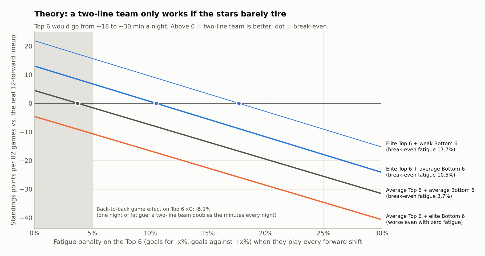

| Team type | Break-even fatigue |
|---|---|
| Average Top 6 + average Bottom 6 (league) | **3.5-3.7%** |
| Elite Top 6 + average Bottom 6 | 10.5% |
| Elite Top 6 + weak Bottom 6 | 17.7% |
| Average Top 6 + elite Bottom 6 | worse even with zero fatigue |

**Fatigue anchor from real data.** On the second night of a back-to-back, with team-season fixed effects, Top 6 expected goals drop **5.1% (±0.8%)**, Top 6 points **7.2%**, team goals for **6.7%**, and goals against rise **6.0%**. One day of fatigue therefore already costs more than the 3.5% an average team can afford. A two-line team would add 12 extra minutes every night inside the same game, so its real fatigue penalty would almost certainly be much larger.

**Verdict:** "no Bottom 6" only works on paper. It needs an elite Top 6 and a Bottom 6 so bad that 30-minute stars are still the better option.

---

## 5. Theory B: what Bottom 6 traits help any team win?

Partial correlations between Bottom 6 traits and points %, **controlling for Top 6 quality, special teams and goaltending** (goals saved above expected):

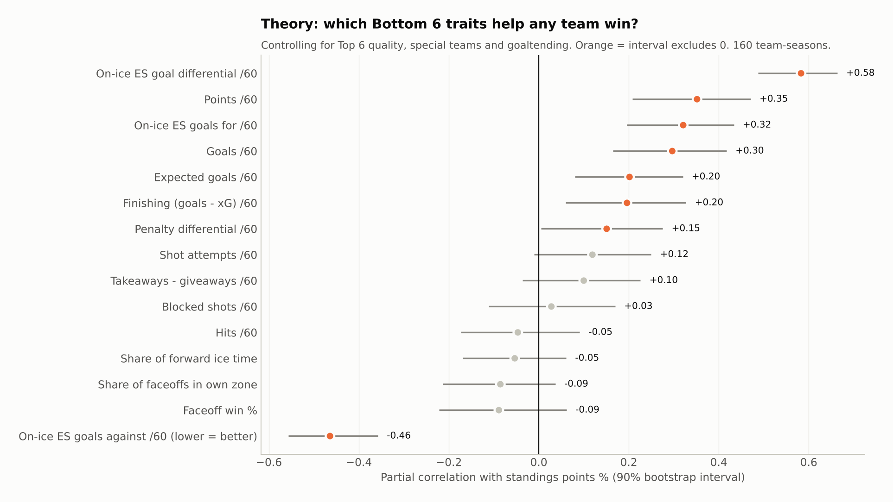

| Matters (90% interval excludes 0) | Partial r | Doesn't matter | Partial r |
|---|---|---|---|
| On-ice ES goal differential /60 | **+0.58** | Hits /60 | -0.05 |
| On-ice ES goals **against** /60 | **-0.46** | Blocked shots /60 | +0.03 |
| Points /60 | +0.35 | Faceoff win % | -0.09 |
| On-ice ES goals for /60 | +0.32 | Share of own-zone faceoffs | -0.09 |
| Goals /60 | +0.30 | Share of forward ice time | -0.05 |
| Expected goals /60 | +0.20 | Takeaways - giveaways /60 | +0.10 |
| Finishing (goals - xG) /60 | +0.20 | Shot attempts /60 | +0.12 |
| Penalty differential /60 | +0.15 | | |

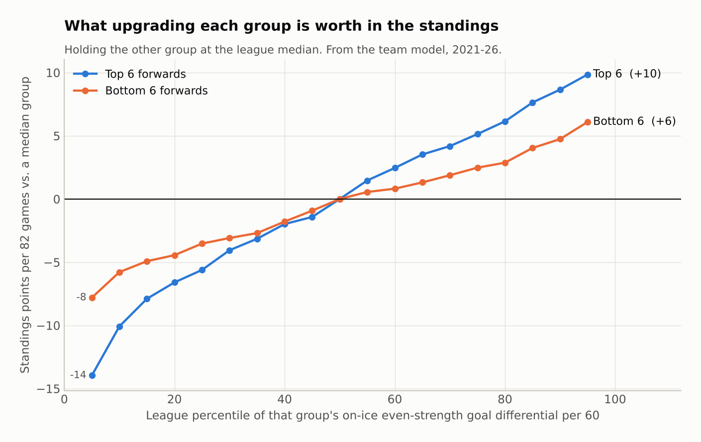

Moving a Bottom 6 from the 10th to the 90th percentile is worth about **10.5 standings points** per 82 games. The same move for a Top 6 is worth 18.7. A depth upgrade is worth a little more than half a Top 6 upgrade in the standings; whether it is the better buy depends on price, and salaries are not part of this dataset.

### The Bottom 6 checklist (what the data says helps *any* team)
1. **Don't lose your minutes.** Suppressing goals against is the biggest single bottom-6 lever. A Bottom 6 at even goal differential beats one that scores more but bleeds chances.
2. **Chip in about one goal a night.** The average Bottom 6 scores 0.78 per game, and the lift is largest exactly when the stars go cold (+32 points of win % when the Top 6 score once).
3. **Finish what you get.** Bottom 6 groups that beat their xG win more. Shooting talent in a depth forward is undervalued.
4. **Stay out of the box and draw penalties.** The Bottom 6 take 33% more penalties per minute than the Top 6, and penalty differential is a significant positive trait.
5. **Don't pay for hits, blocks or faceoffs.** They are the most visible Bottom 6 stats and they show no link to winning once goal differential is known.

---

## 6. Playoffs

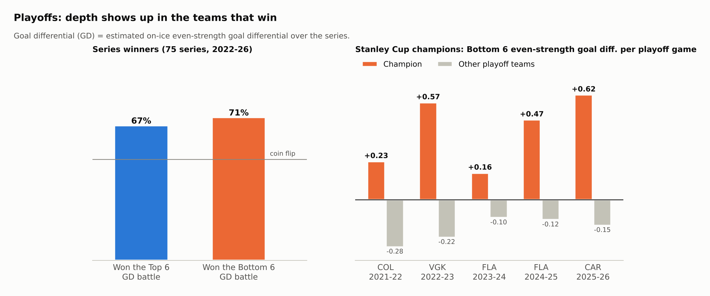

* The Bottom 6 play slightly less in the playoffs (39.1% vs 40.6% of forward TOI) and score slightly less (22.8% vs 25.2% of team goals).
* Over **75 series**, the winner had the better Bottom 6 even-strength goal differential **71%** of the time, slightly more often than it had the better Top 6 goal differential (67%).
* **All five champions** had a Bottom 6 with positive even-strength goal differential in their Cup run. The other playoff teams' Bottom 6 groups averaged negative every year.

| Champion | Bottom 6 ES GD / game | Other playoff teams | Bottom 6 share of team goals (champion vs all playoff teams) |
|---|---|---|---|
| 2021-22 COL | +0.23 | -0.28 | 16.5% vs 20.5% |
| 2022-23 VGK | +0.57 | -0.22 | 28.4% vs 24.2% |
| 2023-24 FLA | +0.16 | -0.10 | 20.5% vs 21.2% |
| 2024-25 FLA | +0.47 | -0.12 | 20.2% vs 21.0% |
| 2025-26 CAR | +0.62 | -0.15 | 34.8% vs 27.4% |

Champions don't always get *more scoring* from their depth (COL and FLA didn't), but every one of them had a Bottom 6 that **won its minutes**.

---

## 7. Robustness

Re-running the core results with the Top 6 defined by **that game's TOI** instead of season role:

| | Season role (main) | In-game TOI |
|---|---|---|
| Bottom 6 share of team goals | 25.2% | 25.9% |
| Logit coefficient per Top 6 / Bottom 6 goal | 1.21 / 1.19 | 1.19 / 1.25 |
| Win % when Bottom 6 score vs don't | 62.4% / 36.0% | 63.7% / 34.3% |

## 8. Limitations

* **No real on-ice data.** Even-strength goals for and against by line group are *estimates* rebuilt from +/-, scorer credits and manpower time. They are internally consistent but not shift-level truth. Lines are also not perfectly separated: a 2nd-line winger sometimes plays with the 3rd line.
* **Quality of competition is not controlled.** Bottom 6 forwards mostly face other Bottom 6 forwards, so their goals-against rates are flattered.
* **Correlation, not causation.** The team-level analyses rest on 160 team-seasons. Strong teams can afford good depth, and good depth is partly a product of good coaching and systems.
* **The two-line scenario is a theoretical model.** Its fatigue penalty is a free parameter. Back-to-back games are only a lower-bound anchor, and they also include travel and backup goalies.
* **Model scope.** xG uses location, shot type and context, with no pre-shot passes or screens. The win-probability model uses clock and score only, not team strength.

## 9. Reproduce

```bash
pip install -r requirements.txt
./run_all.sh            # fetch (~8 min, cached) -> build -> models/features -> analysis + figures
```

Pipeline:
1. `src/fetch_games.py`: raw boxscore and play-by-play JSON into `data/raw/` (git-ignored).
2. `src/build_dataset.py`: player-game, shot, goal and manpower tables.
3. `src/features.py`: xG and win-probability models, Top 6 / Bottom 6 roles, even-strength cleaning, team-game and team-season tables.
4. `src/analysis.py`: every chart in `figures/`, every table in `results/`, and `results/summary.json`.
